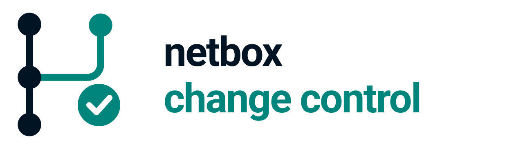
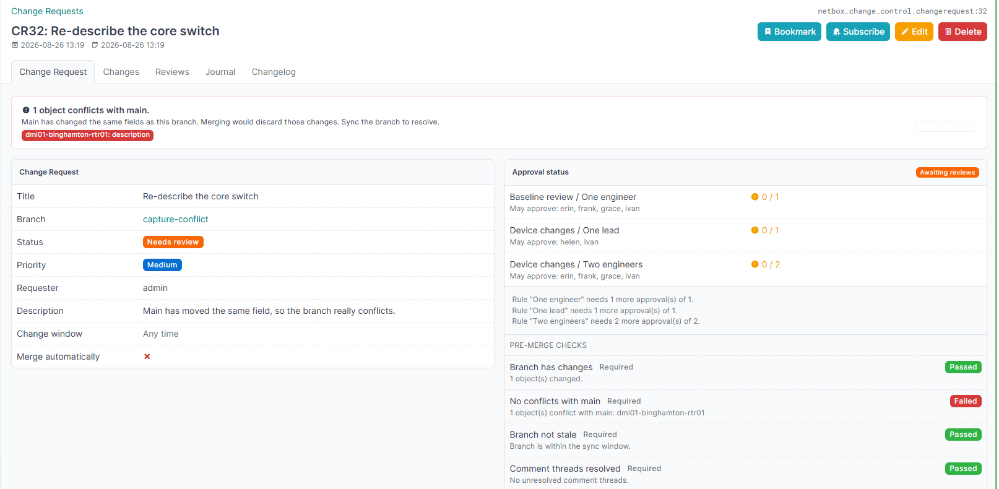

<div align="center">
  
  <p><strong>Policy-driven change control and mandatory review for NetBox branches</strong></p>
  <p>change requests &bull; policies &bull; checks &bull; comments</p>
  <a href="https://pypi.org/project/netbox-change-control/"></a>
  <a href="https://github.com/antoinekh/netbox-change-control/actions/workflows/tests.yaml"></a>
  
  
  
  
  <p>
    <strong><a href="https://antoinekh.github.io/netbox-change-control/">Documentation</a></strong> |
    <strong><a href="https://antoinekh.github.io/netbox-change-control/installation/">Install</a></strong> |
    <strong><a href="https://antoinekh.github.io/netbox-change-control/compatibility/">Compatibility</a></strong> |
    <strong><a href="https://antoinekh.github.io/netbox-change-control/policies/">Policies</a></strong> |
    <strong><a href="https://antoinekh.github.io/netbox-change-control/checks/">Checks</a></strong> |
    <strong><a href="https://antoinekh.github.io/netbox-change-control/changelog/">Changelog</a></strong>
  </p>
</div>

This plugin builds on [netbox-branching](https://github.com/netboxlabs/netbox-branching). A branch stages your changes; this plugin decides who must approve them and refuses the merge until they have.

Who must approve is decided by what the branch changes, not by who opened it. Two independent gates guard the merge: **people** approve through policies, and **pre-merge checks** verify. A check can be your own Python function or a result that CI posts over the REST API, so the gate can wait for a pipeline or [ask a model to review the diff](https://antoinekh.github.io/netbox-change-control/custom-checks/).

<p align="center">
  <a href="#how-it-works">How it works</a> |
  <a href="#features">Features</a> |
  <a href="#requirements">Requirements</a> |
  <a href="#quick-install">Quick install</a> |
  <a href="#documentation">Documentation</a>
</p>

https://github.com/user-attachments/assets/9084f634-e8b7-4dc0-9d38-cf4d4c36c35d

> [!NOTE]
> **Independent community plugin.** Free, MIT licensed, not official, not certified and not endorsed by NetBox Labs. It bundles no netbox-branching code. You install that package yourself, and its own licence governs how you may use it.
>
> No commercial support. If you need a supported product, use the [NetBox Labs](https://netboxlabs.com/docs/changes/) change management plugin.

<details>
<summary><strong>Inspiration</strong></summary>

This plugin takes ideas from:

- **[NetBox Labs change management](https://netboxlabs.com/docs/changes/)**: policies and rules governing who must review a branch.
- **GitHub**: status checks that gate a merge independently of human approval, and review comments anchored to a specific change.
- **[Infrahub](https://docs.infrahub.app/topics/proposed-change)** by OpsMill: a proposed change as a first-class object that carries its own validation.

</details>

<p align="center">
  
</p>

## How it works

1. Someone creates a branch and makes their changes inside it, as normal for netbox-branching.
2. They open a **change request** against that branch.
3. The plugin reads which object types the branch touches and attaches every **policy** whose scope matches. A policy can narrow further on the values of the objects themselves. The author cannot remove them.
4. Each policy contains **rules**. A rule says how many approvals it needs and who may give them.
5. Reviewers **approve**, request changes, or comment. They can also comment on one specific changed object.
6. Independently, the **pre-merge checks** named by those policies run. A required check that is not passing blocks the merge on its own.
7. Once every rule is satisfied and every required check passes, the **merge** button appears.
8. After the merge, the request is marked completed.

Two gates guard the merge and they are independent: the people gate (policies and reviews) and the machine gate (checks). A change can be approved by every reviewer and still be refused by a check.

## Features

**Change requests**

- One change request per branch, with a status and a priority.
- Status set to **completed** after a successful merge, and back to draft with stale reviews after a revert.
- A History tab with each status change, its approvers, and every merge and revert.
- A change request survives the deletion of its branch.

**Policies and reviews**

- Policies containing rules with a minimum approval count, naming reviewer groups and individual reviewers.
- Policies attached automatically, scope-matched from the branch contents and following it as it changes. The author cannot select or remove them.
- Policy conditions, narrowing a policy on the values of the changed objects.
- Reviews with approve, request changes, and comment.
- Per-change comments on the branch diff, with threaded replies, in Markdown.
- Approvals go stale when the branch changes after them.
- Policies reevaluated when a rule, a reviewer or a group membership changes.
- Notifications to reviewers, through NetBox's notification inbox.

**Merge gate**

- Pluggable pre-merge checks, in-process or reported over the REST API.
- Merge button once the change request is approved, on the change request and on the branch.
- Change windows, with an override permission.
- Automatic merge once every gate is satisfied.
- The gate is enforced whether or not `protect_main` is on.

**Protecting main**

- `protect_main` blocks direct edits outside a branch, optionally scoped, with a bypass permission.

**API**

- REST API for every model.

## Requirements

| Component | Version |
|---|---|
| NetBox | `>= 4.7.6, < 4.8` |
| netbox-branching | `>= 1.2.2, < 1.3` |
| Python | `>= 3.12` |

This is the NetBox 4.7 line. For NetBox 4.6, stay on the 0.4.x line; the two do not overlap, because netbox-branching 1.1.x and 1.2 do not either. [The compatibility matrix](COMPATIBILITY.md) has every release, and [Installation](https://antoinekh.github.io/netbox-change-control/installation/#upgrading-from-the-46-line) covers moving between the two lines.

## Quick install

```python
# configuration/plugins.py
PLUGINS = [
    'netbox_change_control',
    'netbox_branching',          # must stay last
]

PLUGINS_CONFIG = {
    'netbox_branching': {
        'exempt_models': ['netbox_change_control.*'],   # required
    },
}
```

```bash
./manage.py migrate netbox_change_control
```

See [Installation and configuration](https://antoinekh.github.io/netbox-change-control/installation/) for the detail, including why `exempt_models` is not optional.

## Documentation

The full documentation is a website: **[antoinekh.github.io/netbox-change-control](https://antoinekh.github.io/netbox-change-control/)**. Start with:

| Page | Covers |
|---|---|
| [Installation and configuration](https://antoinekh.github.io/netbox-change-control/installation/) | Requirements, installing, and every setting. |
| [Policies and rules](https://antoinekh.github.io/netbox-change-control/policies/) | Scoping a policy and writing rules. |
| [Pre-merge checks](https://antoinekh.github.io/netbox-change-control/checks/) | What checks are and which ship built in. |
| [Writing your own checks](https://antoinekh.github.io/netbox-change-control/custom-checks/) | The registry, an AI reviewer, and reporting from CI. |
| [REST API](https://antoinekh.github.io/netbox-change-control/api/) | Every endpoint. |
